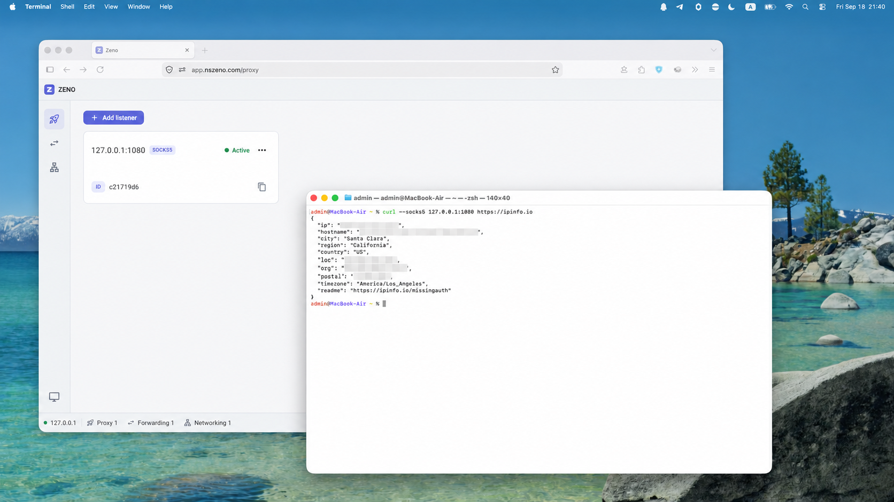
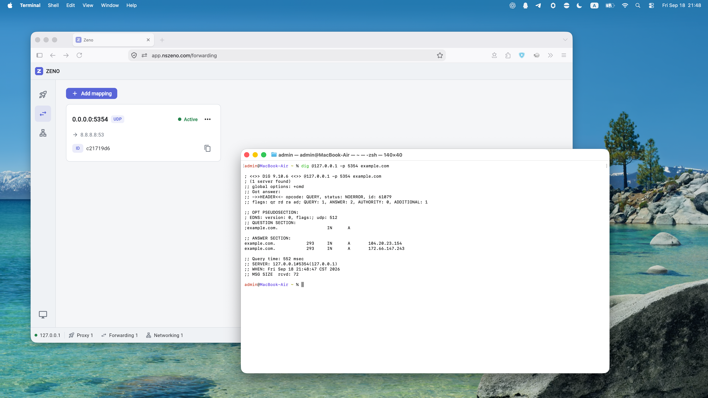
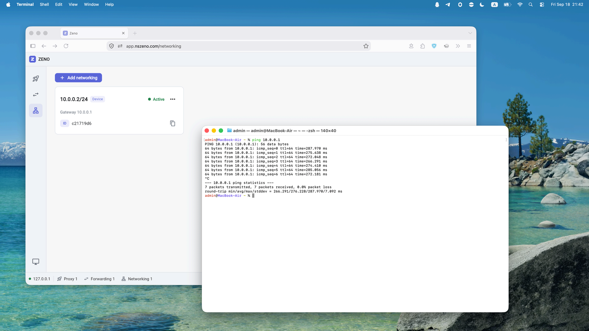

# Zeno

**無需公網 IP，連接異地裝置與服務。**

[English](README.md) | [简体中文](README.zh-hans.md) | **繁體中文** | [日本語](README.ja.md) | [한국어](README.ko.md) | [Español](README.es.md) | [Русский](README.ru.md)

## SOCKS5 代理

透過遠端裝置，存取它所在的網路。



## 連接埠轉發

將遠端 TCP / UDP 服務，對應至本機連接埠。



## 虛擬組網

透過閘道連接異地區域網路，存取其中的裝置。



## 開始使用

在本機和遠端裝置上安裝 Zeno Daemon：

安裝需要系統管理員權限，用於設定開機啟動，以及建立虛擬網路介面和設定路由，以支援私有網路功能。

**macOS**

```sh
curl -fsSL https://dl.nszeno.com/daemon/macos-installer | bash
```

**Linux**

```sh
curl -fsSL https://dl.nszeno.com/daemon/linux-installer | bash
```

**Windows（系統管理員 PowerShell）**

```powershell
irm https://dl.nszeno.com/daemon/windows-installer | iex
```

安裝後，[開啟控制台](https://app.nszeno.com)，使用遠端裝置的 Peer ID 設定代理、轉發或組網。
